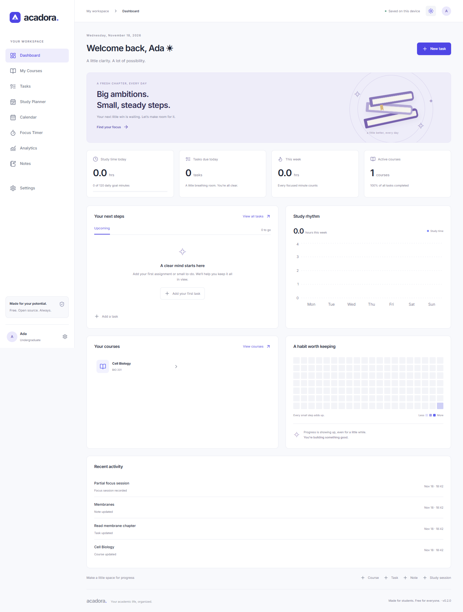

# Acadora

**Your academic life, organized.**

Acadora is a free, open-source academic productivity platform for students worldwide. Organize courses, manage assignments, plan study sessions, track focus time, and understand your academic productivity.

Our mission is to make high-quality academic productivity tools accessible regardless of country, institution, academic background, or financial situation. No advertisements, subscription, premium features, or mandatory registration.

## Features

- Calm, responsive workspace with light, dark, and system themes; locally hosted Inter fonts and original geometric branding.
- Skippable onboarding with name, academic level, daily goal, and appearance preferences.
- Dashboard with real study totals, deadlines, course summaries, activity, weekly chart, and 140-day study heatmap. New workspaces start empty.
- Courses with colors, codes, instructor, institution, semester, description, credits, archival, and course details.
- Tasks with status, priority, date and time, course, tags, estimated and actual minutes; search, filters, sorting, and completion.
- Daily and weekly study planning with linked tasks, editable time ranges, and overlap warnings.
- Month, week, and day calendar with tasks, study blocks, examinations, and custom events.
- Timestamp-based focus timer, custom durations, short and long breaks, pause/resume/reset, partial session recording, linked courses/tasks, and history.
- Date-filtered study totals, daily averages, task completion, productive days, course distribution, weekly trends, and heatmap.
- Markdown notes with debounced autosave, preview, search, tags, pinning, sorting, and Markdown download.
- Complete validated JSON backup and transactional replacement restore; CSV task/session exports; confirmed data deletion.
- Installable PWA with offline asset caching in production.

## Screenshots

Screenshots from the tested production build contain only test workspace data. No sample academic activity is inserted into a real workspace.



[简体中文 dashboard](docs/dashboard-chinese.png) · [Dark dashboard](docs/dashboard-dark.png) · [Mobile focus timer](docs/focus-mobile.png)

## Run locally

Anyone can run Acadora on Windows, macOS, or Linux without an account, backend, API key, or payment. Install **Node.js 22.12 or newer** (includes npm) from [nodejs.org](https://nodejs.org/) and **Git** from [git-scm.com](https://git-scm.com/). Open PowerShell on Windows or Terminal on macOS/Linux.

### Quick start with npm

```sh
git clone https://github.com/danish-yaqoob/acadora.git
cd acadora
npm install
npm run dev
```

Open **http://127.0.0.1:5173/**, or the exact local URL Vite prints if that port is busy. Leave the terminal open while using the app; press **Ctrl+C** to stop it. To start it again, enter the `acadora` folder and run `npm run dev`. You only need to install dependencies the first time or after dependency changes.

If you prefer not to install Git, select **Code → Download ZIP** on the GitHub repository, extract it, open a terminal in the extracted folder containing `package.json`, and run `npm install` followed by `npm run dev`.

### Reproducible development with pnpm

The committed lockfile uses pnpm 11.25.0. After cloning and entering the project folder:

```sh
npm install --global pnpm@11.25.0
pnpm install --frozen-lockfile
pnpm dev
```

### Build and use offline

```sh
npm run build
npm run preview
```

Open **http://127.0.0.1:4173/** online and wait for the offline-ready message. The production preview caches the application for offline access on that same browser and origin. Development mode does not register a service worker. Where supported, use the browser's **Install app / Add to Home Screen** action to install the PWA. Data stays on each device; use JSON backup/restore to move it between devices.

For phone access, deploy the production `dist/` folder to an HTTPS host and open that site on the phone. A computer's `127.0.0.1` address cannot be opened from another device. An HTTPS origin is required for remote PWA installation and service workers.

### Update an existing checkout

Back up your data in Settings first, then stop the server and run:

```sh
git pull --ff-only
npm install
npm run dev
```

Use the same browser and local URL to retain access to your stored workspace. Installed production apps show a reload prompt when an updated build is available.

### Change language / 切换语言

Choose **Settings → Language → 简体中文 → Save preferences**. To switch back, choose **设置 → 语言 / Language → English → 保存偏好设置**. Language is also available during onboarding and is saved locally, survives refresh, and is included in JSON backups. Existing workspaces and older backups default to English. Interface labels, dates, dialogs, and controls are localized; your course names, tasks, and note contents are never automatically translated.

在“设置”中，将“语言 / Language”选择为“简体中文”，然后保存偏好设置。无需账户，也不需要联网翻译。下载源代码后，在项目目录运行 `npm install` 和 `npm run dev`，再打开终端显示的本地网址即可。

### Development checks

```sh
pnpm lint
pnpm typecheck
pnpm test
pnpm build
pnpm exec playwright install chromium
pnpm test:e2e
pnpm preview
```

The browser suite starts the built production app at `http://127.0.0.1:4173`. Build first. Development mode does not register the offline service worker.

## Privacy, offline access, and backups

Academic records live in IndexedDB in the current browser profile and origin. The active timer uses a small localStorage record so refreshes retain its timestamp. The app makes no academic-data requests, contains no telemetry, and bundles its fonts. There is no backend, account, or cloud sync.

Data is **not encrypted by Acadora**. Anyone with access to your unlocked browser profile may access it. Clearing browser storage, private browsing, browser eviction, changing origin, or changing devices can lose local records. Download regular JSON backups using **Settings → Download complete JSON backup**. Keep backup files private. To migrate, open Acadora on the new device and choose **Restore JSON backup**. Restoration validates version, models, identifiers, relationships, dates, and session durations before replacing records inside a single transaction. It replaces, rather than merges, the current workspace. Invalid backups leave the workspace unchanged. The UI limits imports to 20 MB.

After opening the production build online and allowing asset caching to finish, it works offline on the same origin. Installation is optional; install prompts depend on the browser. Production hosting requires HTTPS (localhost is also supported). Browser storage and service workers must be enabled. The app announces when offline caching is ready and offers a reload when an update is available.

## Time and calculation behavior

Dates are stored as ISO timestamps and displayed in the device's local time zone. Calendar weeks respect your selected starting day. Planner editing uses local date/time inputs, so verify times when crossing a daylight-saving transition or changing time zones. Timer deadlines use wall clock timestamps; pauses preserve remaining milliseconds and are never added to study totals. Finishing early records only elapsed focus time; resetting discards it. Sleeping past a deadline caps the record at the requested duration. Breaks never count as study time. Desktop notifications need browser permission; the app shows an in-app completion message regardless. A closed browser cannot deliver notifications; on reopening, the timestamp is reconciled.

Analytics split a session's recorded seconds proportionally across the wall-clock interval if it crosses a selected date boundary. Because pause segments are not separately stored, the exact distribution around midnight during a pause is approximate; total study seconds remain exact. Task completion in a selected range uses the last updated time of currently completed tasks, not an immutable completion ledger. The heatmap covers the latest 140 days, and the weekly chart always shows the current week.

## Architecture

React, TypeScript, Vite, Tailwind CSS, Lucide, Zustand, Dexie/IndexedDB, React Hook Form, Zod, Recharts, date-fns, react-markdown, Vitest, React Testing Library, Playwright, and vite-plugin-pwa. Lightweight native accessible controls and HTML dialogs provide the UI primitives; shadcn/ui is not required for these controls.

- `src/data.ts`: typed models, version 1 database schema, import validation, transactions, deletion policy, exports, and calculations.
- `src/timer.ts`: persisted timestamp timer state and idempotent recording.
- `src/App.tsx`: navigation, onboarding, dashboard, courses, and tasks.
- `src/Editor.tsx`: validated course/task/plan/event forms.
- `src/Focus.tsx`, `Schedule.tsx`, `Notes.tsx`, `Insights.tsx`, `Settings.tsx`: feature screens.
- `src/ui.tsx`, `src/style.css`: shared controls and responsive design system.

All personal data operations go through the database boundary. Optional future sync can be added at this boundary using stable IDs and update timestamps. A future schema migration must introduce a new Dexie version without rewriting version 1. Deleting courses detaches records into independent study; deleting a task clears linked task references from plans and sessions. There is no remote synchronization now. Single active timer tab is recommended; cross-tab leadership is not yet implemented.

## Accessibility and internationalization

Labeled inputs, keyboard-operable controls, native focus-trapped modal dialogs, a skip link, status messages, mobile navigation, and reduced-motion support are included. English and Simplified Chinese (`zh-CN`) are supported through `src/i18n.ts` and `src/zh-CN.json`. Dates use the selected language and device time zone; 12/24-hour time and Sunday/Monday weeks are configurable. Stored enum values stay stable across languages. Database version 2 adds the language preference without changing academic records; legacy version 1 backups remain importable. Manual screen-reader and cross-browser accessibility audits are still recommended before broad release.

## Release status and roadmap

This is version **0.2.0**. The source repository is [danish-yaqoob/acadora](https://github.com/danish-yaqoob/acadora). See `VALIDATION.md` for executed checks and limitations. A hosted production website is not configured. Before a broad production launch, review dependency updates, audit accessibility in target browsers, and establish maintainer/security contact details.

Roadmap: additional languages; sync as an explicitly optional adapter; exact pause-segment analytics; multi-tab timer ownership; drag-and-drop planning (sessions can already be rearranged by editing); richer course-note navigation; immutable completion history; browser and assistive-technology coverage.

## Contributing

See [CONTRIBUTING.md](CONTRIBUTING.md), [CODE_OF_CONDUCT.md](CODE_OF_CONDUCT.md), and [SECURITY.md](SECURITY.md). Contributions must preserve the free, local-first product and must not add tracking or mandatory registration.

## Publish to GitHub

Install and authenticate GitHub CLI, then run from this directory. Substitute your GitHub username or organization for `YOUR_ACCOUNT`:

```sh
gh auth login
git init -b main
git add .
git commit -m "Release Acadora 0.2.0"
gh repo create YOUR_ACCOUNT/acadora --public --source=. --remote=origin --description "Acadora is a free, open-source academic productivity platform for students worldwide. Organize courses, manage assignments, plan study sessions, track focus time, and improve your academic productivity." --push
git tag v0.2.0
git push origin v0.2.0
gh release create v0.2.0 --title "Acadora 0.2.0" --notes-file CHANGELOG.md
```

To host, run `pnpm build` and serve `dist/` at an HTTPS origin's root, with SPA fallback to `index.html`. Vite preview is a local verification server, not a production server. For GitHub Pages under `/acadora/`, configure Vite's `base`, PWA paths, and icons for the subpath before deploying. This repository does not publish a site automatically.

## License

GNU Affero General Public License version 3 only, [AGPL-3.0](LICENSE). The full official license text is included. Dependencies retain their own licenses. Original Acadora source, visual identity, and CSS illustration were created for this project.
